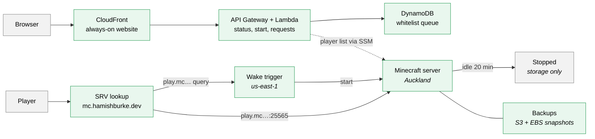
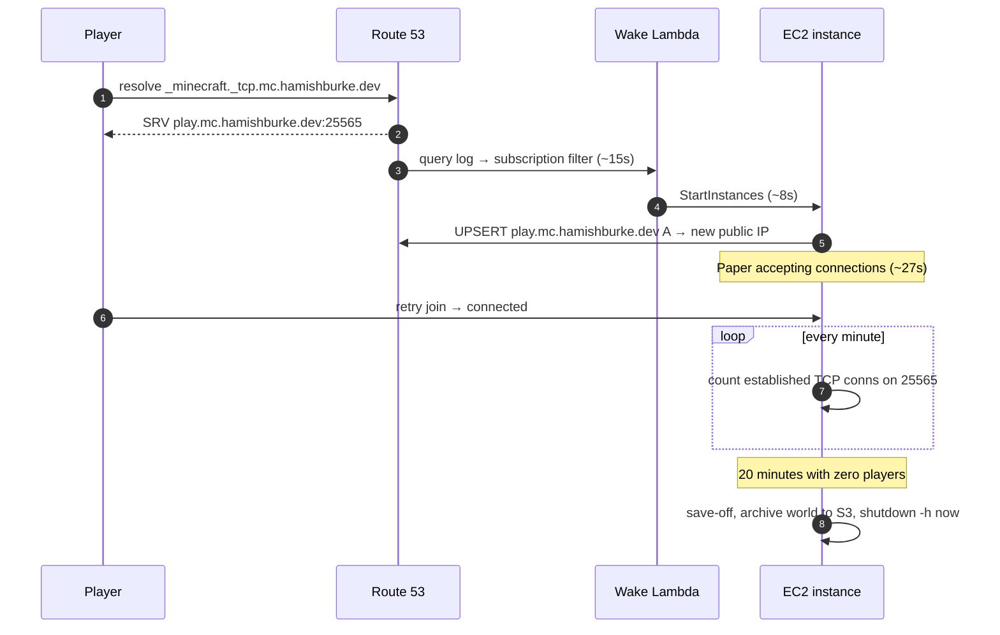

# Architecture

## Infra overview

## Wake and sleep sequence diagram

Measured end to end at ~50 seconds on 26 July 2026, against a 2-minute
requirement. Most of that is CloudWatch Logs delivery, which isn't tunable.
